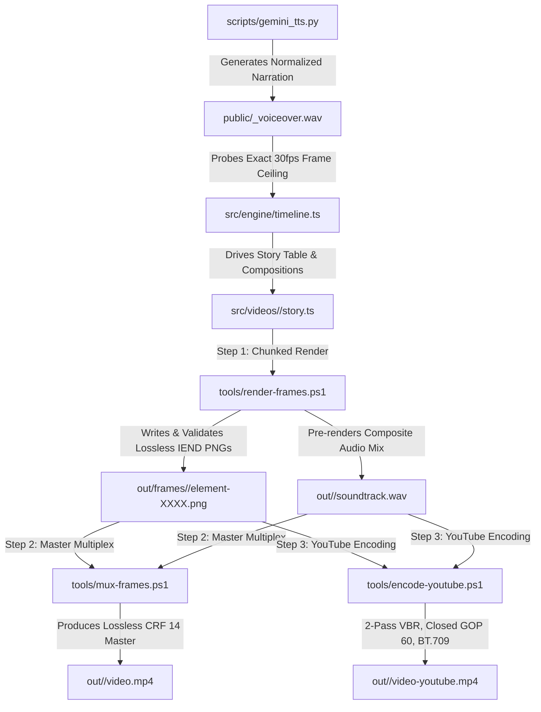

# 2.5D Cel-Shaded Cartoon Story Video Generator (Ricks Clips Style)

An autonomous AI story video production pipeline for vertical YouTube Shorts, matching the signature visual style of Ricks Clips (*"The Job Nobody Wants in Japan"*).

Built with **Remotion**, **Three.js / React Three Fiber**, and **Google Gemini TTS**.

---

## Visual Architecture & Engine Features

1. **3D Cel-Shaded Worlds (`ThreeCanvas` + `LookMatchPipeline`)**:
   - Saturated geometric environments with custom screen-space edge ink outlines (`InkPass`).
   - Organic 12 FPS line boiling (`boil: true`, `boilScale: 0.35`) for hand-drawn analog vitality.
   - Half-tone comic stippling in shadow regions via `cardShade(material, { halftone: true })`.
   - Thin-lens optical depth of field (`LensBlur`) using a 64-tap Vogel disc with Golden Ratio spacing.
2. **2D Cartoon Character Cards (`toon.ts` + `rig.ts`)**:
   - Bean- and egg-shaped heads, dot/circle eyes, dynamic cartoon mouths, and noodle limbs with dark plum ink outlines (`#241726`).
   - **2D Inverse Kinematics (`rig.ts`)**: Analytical 2-bone planar IK solver (`solve2BoneIK`) driving natural gestures (`point`, `wave`, `akimbo`, `shrug`, `alarm`) without ad-hoc pixel coordinate math.
   - **Procedural Character Vitality (`vitality.ts`)**: Automatic eye blinking (every 2.5–4s), breathing idle vertical float, volume-preserving chest expansion, and damped harmonic squash-and-stretch on shock events.
3. **Floor Pools & Contact Shadows (`floorpool.ts`)**:
   - `FloorPoolManager` automatically projects warm golden spotlight pools (`#FFEAA7`) and multiply-blended contact occlusion shadows directly beneath actors, dynamically scaling and fading as actors jump.
4. **Cinematography & Retention Grammar (`camera.ts` + `retention.ts`)**:
   - 9:16 vertical frustum clamping (`clampActorToFrustum`) preventing actors from clipping lateral screen borders.
   - **2.5s Snap Zoom Rule (`getSnapZoom`)**: Instant 6–8% FOV micro-punches that interrupt viewer fatigue.
   - **Infinite Loop Outro (`getLoopBlend`)**: Smoothly blends camera position and focal target back into frame 0 over the final 15 frames for >100% Average Percentage Viewed (APV).
5. **Kinetic Captions & Soundscape**:
   - **`KineticCaptions` (`KineticCaptions.tsx`)**: Placed at `bottom: 380px` (above the YouTube Shorts UI rail). Spoken words pop with Remotion `spring()` physics in vibrant electric gold (`#FFE600`) with alternating $\pm 1.8^\circ$ cartoon tilt.
   - **`Soundscape` (`audio.tsx`)**: Subtle pizzicato background bed ducked dynamically to 0.08 during narration, accented by synchronized subtle cartoon Foley SFX (`whoosh`, `pop`, `clang`, `thud`, `boing`).

---

## Active Compositions

| Composition ID | Length | Description |
| :--- | :---: | :--- |
| **`CartoonShortsTemplate`** | 360 f (12.0 s) | **Upgraded Engine Showcase & Blueprint** for all future shorts. |
| **`EmuWar`** | 1,460 f (48.7 s) | *The Great Australian Emu War of 1932* (10-shot full story). |
| `EmuWarShowcase` | 180 f (6.0 s) | 6-second hook check for Emu War. |
| **`MolassesFlood`** | 1,586 f (52.9 s) | *The Boston Molasses Disaster of 1919* (9-shot full story). |
| `MolassesShowcase` | 180 f (6.0 s) | 6-second hook check for Molasses Flood. |
| **`MonaLisaHeist`** | 1,667 f (55.6 s) | *The 1911 Theft of the Mona Lisa* (8-shot full story). |
| `MonaLisaShowcase` | 180 f (6.0 s) | 6-second hook check for Mona Lisa Heist. |
| **`RicksClipsFull`** | 1,956 f (65.2 s) | *Broughton Suspension Bridge Collapse of 1831* (15-shot full story). |
| `RicksClipsShowcase` | 180 f (6.0 s) | 6-second hook check for Bridge short. |
| `RicksClipsDemo` | 708 f (23.6 s) | 5-scene typography teaser (Lustig Eiffel Tower). |

---

## Quick Start & CLI Workflows

### 1. Prerequisites
- **Node.js**: v20 or higher
- **PowerShell**: Windows PowerShell 5.1 or PowerShell Core (with execution policy enabled)
- **Python**: 3.10+ (with `python-dotenv`) for TTS voice generation
- **Hardware Acceleration**: GPU supporting Direct3D 11 (ANGLE). Remotion runs with `--gl=angle` and `concurrency: 2`.

### 2. Setup
```bash
git clone <YOUR_REPO_URL>
cd c2v-gen-yt-skill
npm install
```
Configure your Gemini API key in `.env` (copy from `.env.example`):
```bash
GEMINI_API_KEY="your-gemini-api-key-here"
```

### 3. NPM Scripts Reference

```bash
npm start                 # Launch interactive Remotion Studio preview
npm run check             # Run strict TypeScript static analysis (tsc --noEmit)
npm run tts               # Generate voiceover via Gemini TTS with -14 LUFS normalization
npm run render:chunks     # Render lossless PNG frame chunks (tools/render-frames.ps1)
npm run render:audio      # Render composite soundtrack.wav (music bed + Foley SFX + narration)
npm run mux               # Package PNG chunks + soundtrack into master video (tools/mux-frames.ps1)
npm run encode:youtube    # Encode 2-pass VBR closed-GOP YouTube Shorts upload (tools/encode-youtube.ps1)
npm run render            # Trigger nightly queue pipeline (tools/nightly-render.ps1)
npm run still             # Capture a single PNG still of EmuWar
```

---

## Production Pipeline Architecture

### Resumable Chunked Rendering Rule
Never render full compositions with a direct single pass (`remotion render out/video.mp4`). A crash, GPU reset, or power cut discards all progress. All production renders use the resumable two-pass pipeline:



1. **Step 1: Visual Frames & Soundtrack Generation**
   ```powershell
   powershell -NoProfile -ExecutionPolicy Bypass -File tools/render-frames.ps1 -Composition CartoonShortsTemplate -Chunk 150
   ```
   - Renders lossless PNG frames into `out/frames/<slug>/element-XXXX.png` in 150-frame chunks.
   - Automatically validates PNG `IEND` footer signatures (`0x49, 0x45, 0x4E, 0x44`) and file size ($\ge 10\text{ KB}$), re-rendering any incomplete or interrupted frames.
   - Skips finished chunks in under 1 second upon resumption.
   - Automatically detects and pre-renders the composite `soundtrack.wav` containing volume-ducked background music and Foley SFX.

2. **Step 2: Master Encode (CRF 14)**
   ```powershell
   powershell -NoProfile -ExecutionPolicy Bypass -File tools/mux-frames.ps1 -FramesDir out/frames/template -Out out/template/video.mp4
   ```

3. **Step 3: YouTube Shorts CDN Deliverable (2-Pass VBR)**
   ```powershell
   powershell -NoProfile -ExecutionPolicy Bypass -File tools/encode-youtube.ps1 -FramesDir out/frames/template -Out out/template/video-youtube.mp4
   ```
   - Output spec: H.264 High Profile, level 4.2, `yuv420p`, constant 30 fps.
   - Bitrate: 8 Mbps 2-pass VBR (12 Mbps max, 16 Mbps buffer), closed GOP 60 ($2.0\text{s}$).
   - Colorimetry: Full BT.709 primaries, transfer, and matrix tagging.
   - Audio: AAC-LC 48 kHz stereo 384 kbps with `+faststart`.

4. **Step 4: Thumbnail & Studio Metadata Generation**
   ```powershell
   powershell -NoProfile -ExecutionPolicy Bypass -File tools/make-thumbnail.ps1 -Composition CartoonShortsTemplate -Frame 165 -OverlayText "THE UPGRADED ENGINE"
   python scripts/generate_youtube_metadata.py --slug template --out out/template
   ```

---

## Repository Layout

```
src/
  engine/                     # Core 2.5D Cel-Shaded Cartoon Engine (Shared)
    timeline.ts               # Universal duration & audio frame synchronizer (zero drift)
    pipeline.ts               # LookMatchPipeline & reusable <Warmup /> gate component
    retention.ts              # 2.5s Snap Zoom, 15-frame infinite loop outro, handheld drift
    rig.ts                    # 2D 2-bone analytical IK solver & declarative gestures
    vitality.ts               # Procedural eye blinking, breathing float, squash & stretch
    camera.ts                 # 9:16 vertical frustum clamping (zero actor border clipping)
    floorpool.ts              # Automatic warm spotlight pools & multiply contact shadows
    audio.tsx                 # Soundscape component (music bed, ducking envelope, cartoon Foley SFX)
    KineticCaptions.tsx       # Bouncing active-word subtitles with alternating cartoon tilt
    ink.ts                    # InkPass edge detection with 12 FPS line boil
    lensblur.ts               # 64-tap Vogel disc thin-lens bokeh blur & film grain
    grade.ts                  # 6-preset color grading engine (day, golden, night_heist, etc.)
    shade.ts                  # PBR Neutral tone inversion & memoized untone() solver
    cardshade.ts              # Billboard character card shader with halftone Ben-Day option
    lights.ts                 # Time-of-day directional sun presets
    paint.ts                  # Procedural canvas textures (planks, cobbles, stone, water)
    toon.ts                   # Pen vector canvas API & outfit generators
  videos/
    template/                 # CANONICAL BLUEPRINT FOR ALL FUTURE SHORTS
      TemplateShort.tsx       # Full showcase composition with Warmup, Soundscape, KineticCaptions
      cast.ts                 # Actor lifecycle with texture dirty-checking
      story.ts                # Camera keyframes, retention punches, SFX triggers, subtitles
      world.ts                # 3D cel-shaded set & lighting
    demo/                     # Legacy Bridge short (Broughton Suspension Bridge)
    emu/                      # Legacy Emu War short
    molasses/                 # Legacy Boston Molasses Flood short
    monalisa/                 # Legacy 1911 Mona Lisa Heist short
  Root.tsx                    # Remotion composition registry
  Composition.tsx             # Text cards teaser demo
tools/
  render-frames.ps1           # Resumable chunked frame renderer with IEND integrity check
  mux-frames.ps1              # Single-pass master CRF 14 multiplexer
  encode-youtube.ps1          # 2-pass YouTube Shorts delivery encoder
  nightly-render.ps1          # Scheduled off-peak batch render queue (4 AM - 7 AM window)
  make-thumbnail.ps1          # High-CTR vertical thumbnail generator with cartoon typography
  setup-wake-timer.ps1        # Registers motherboard ACPI RTC wake timer in Windows Task Scheduler
scripts/
  gemini_tts.py               # Studio voiceover generator with -14 LUFS normalization & frame metadata
  generate_audio_assets.py    # Synthesizes pizzicato bed, whoosh, pop, clang, thud, boing WAVs
  generate_youtube_metadata.py# Generates titles, SEO description, timestamps, tags, and pinned comment
```
